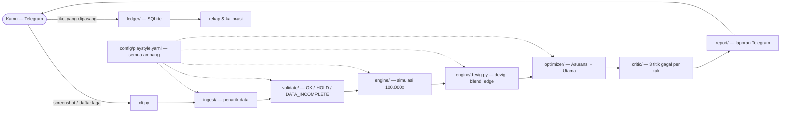

# muse-parlay-analyst

[](https://www.python.org/)
[](https://github.com/dwikabimantara99/muse-parlay-analyst/actions/workflows/tests.yml)
[](https://github.com/psf/black)
[](https://github.com/dwikabimantara99/muse-parlay-analyst)

Mesin analis parlay (NBA + sepak bola) yang **workflow-nya terkunci**.
Bukan bot otomatis: kamu kirim screenshot bursa atau daftar laga lewat
Telegram, mesin menganalisis sedalam mungkin, meracik **Tiket Asuransi +
Tiket Utama**, dan bisa diajak diskusi. Kamu yang memutuskan dan memasang
tiket sendiri secara manual di jup.ag.

Spesifikasi resmi: **Blueprint Mesin Analis Parlay (Muse)** (Nov 20, 2026).
Keputusan setelah blueprint dicatat di [`DECISIONS.md`](DECISIONS.md).
Workflow terkunci ada di [`SOP.md`](SOP.md) — wajib dibaca Muse setiap
Mode Analisis.

## Arsitektur



Satu pintu masuk: `cli.py`. Semua langkah SOP dijalankan berurutan di dalam
pintu itu, jadi tidak ada langkah yang bisa terlewat.

## Alur kerja — 10 langkah terkunci (SOP)

| # | Langkah | Yang terjadi |
| --- | --- | --- |
| 1 | Baca & konfirmasi | Muse membaca screenshot, tampilkan tabel laga untuk dikonfirmasi |
| 2 | Tarik data | Statistik, cedera, lineup, harga pasar lain (berjenjang, §B) |
| 3 | Validasi | Data bolong/basi → `DATA_INCOMPLETE` / `HOLD` |
| 4 | Simulasi 100.000x | NBA Student-t + OT; bola Dixon-Coles; skenario skuad |
| 5 | Bandingkan pasar | Devig, blend model-pasar, edge, EV |
| 6 | Deteksi anomali | Selisih harga/model yang aneh wajib dijelaskan dulu |
| 7 | Filter keras | Kaki yang kena aturan coret dibuang, alasan dicatat |
| 8 | Racik tiket | Optimizer: 3 pasangan Asuransi + Utama terbaik |
| 9 | Kritikus | 3 titik gagal terburuk per kaki + pemain sakelar |
| 10 | Laporan & catat | Laporan 7 bagian; tiket yang dipasang masuk ledger |

Kalau ada langkah yang dilewati, laporan dianggap **tidak sah**.
Detail lengkap: [`SOP.md`](SOP.md).

## Peta folder

```text
muse-parlay-analyst/
├── config/
│   ├── playstyle.yaml        # SEMUA ambang & default strategi (satu sumber)
│   └── sources.yaml          # sumber data berjenjang 1–3 + cadangan
├── DECISIONS.md              # keputusan setelah blueprint (pelengkap resmi)
├── SOP.md                    # workflow terkunci yang wajib dibaca Muse
├── schemas/                  # skema JSON: slate, match_data, simulation, leg, ticket
├── examples/                 # contoh slate + tiket (fixture tes)
├── ingest/                   # penarik data per sumber (Tahap 2)
├── validate/                 # cek kelengkapan & umur data (Tahap 2)
├── engine/                   # simulasi NBA/bola, pasar, devig (Tahap 3)
├── optimizer/                # peracik Asuransi + Utama (Tahap 4)
├── critic/                   # kritikus + validator angka (Tahap 4)
├── report/                   # format laporan Telegram (Tahap 4)
├── ledger/                   # SQLite, rekap, kalibrasi
├── scripts/                  # pre-commit hook + pemasangnya
├── config.py                 # loader playstyle.yaml & sources.yaml
├── cli.py                    # satu pintu: analyze / recheck / log / recap
├── pyproject.toml            # metadata + konfigurasi ruff & black
└── tests/                    # tes unittest (stdlib)
```

## Cara instal & menjalankan

```bash
# Python 3.11+ (diuji di 3.12)
git clone https://github.com/dwikabimantara99/muse-parlay-analyst.git
cd muse-parlay-analyst
pip install -r requirements.txt

# Untuk pengembangan (format + lint)
pip install -r requirements-dev.txt
sh scripts/install-hooks.sh   # pasang pre-commit hook (ruff, black, tes)

# API key (opsional di Tahap 1, wajib mulai Tahap 2)
cp .env.example .env   # lalu isi key gratis kamu; JANGAN commit .env

# Jalankan tes
python -m unittest discover -s tests -v

# Periksa kerapian kode
ruff check . && black --check .
```

## Perintah CLI

```bash
python cli.py analyze --input slate.json    # Tahap 2+ (belum tersedia)
python cli.py recheck --ticket <id>         # Tahap 5  (belum tersedia)

# Catat tiket yang sudah dipasang (validasi skema dulu)
python cli.py log --file ticket.json

# Selesaikan tiket PENDING, lengkap dengan hasil per kaki / cashout
python cli.py log --settle <id> --result WIN --leg-result leg-01=WIN --leg-result leg-02=VOID
python cli.py log --settle <id> --result CASHOUT --cashout-amount 75

# Rekap untung/rugi
python cli.py recap            # teks
python cli.py recap --json     # JSON
```

Database default: `ledger.db` di root repo (masuk `.gitignore`).
Pakai `--db <path>` untuk memakai file lain.

Aturan ledger: untung/rugi selalu dihitung kode dari modal × pengali × hasil.
Kaki VOID/PUSH dikeluarkan dan pengali dihitung ulang dari kaki sisanya;
semua kaki VOID/PUSH → tiket VOID. CASHOUT: untung/rugi = cashout − modal.
Detail: [`DECISIONS.md`](DECISIONS.md) bagian A.

## Aturan anti-halusinasi

1. **Angka hanya dari script.** Peluang, simulasi, EV, dan pengali wajib keluar
   dari kode Python. LLM dilarang menulis angka yang tidak berasal dari output
   script.
2. **Nol data = berhenti.** Data gagal diambil → laga `DATA_INCOMPLETE`,
   tidak boleh masuk tiket. Jangan pernah mengisi data kosong dengan tebakan.
3. **Setiap angka ada sumbernya.** Laporan menyebut dari mana data diambil
   dan kapan (jenjang + sumber + jam).
4. **Pasar adalah patokan.** Harga pasar lain dipakai sebagai pembanding
   wajib. Model sendiri tidak boleh dipercaya sendirian.
5. **Semua tercatat.** Setiap tiket yang dipasang masuk ledger supaya
   kualitas mesin bisa diukur jujur.
6. **Semua ambang hanya di `config/playstyle.yaml`.** Tidak ada angka ambang
   di kode, SOP, atau laporan.

## Status tahapan

| Tahap | Isi | Status |
| --- | --- | --- |
| 1 — Pondasi | Struktur repo, `playstyle.yaml`, `SOP.md`, skema JSON, ledger SQLite | ✅ Selesai |
| 2a — Probe | Satu script probe per sumber, tabel hasil sebelum membangun | 🚧 Menunggu persetujuan |
| 2b — Data | Penarik data + validasi sesuai aturan jenjang | 🚧 |
| 3 — Mesin hitung | Simulasi NBA & bola, devig, edge, anomali | 🚧 |
| 4 — Peracik & kritikus | Optimizer, kritikus, validator angka, format laporan | 🚧 |
| 5 — Telegram | Mode Analisis, Mode Diskusi, `cek ulang`, pencatatan via chat | 🚧 |
| 6 — Kalibrasi | Laporan otomatis setiap 50 kaki | 🚧 |

## ⚠️ Disclaimer risiko taruhan

Mesin ini adalah alat analisis, bukan jaminan profit. Peluang yang
dihitung adalah perkiraan model dari data historis dan harga pasar — tidak
ada model yang bisa memprediksi hasil pertandingan dengan pasti. Parlay
memperbesar varians: beberapa kaki yang masing-masing "aman" tetap bisa
kalah bersamaan. **Jangan pernah bertaruh dengan uang yang kamu tidak sanggup
kehilangan.** Semua keputusan pasang tetap di tanganmu; mesin hanya
menyajikan analisis dan angka sejujur mungkin, termasuk saat angkanya
mengatakan "jangan pasang".
